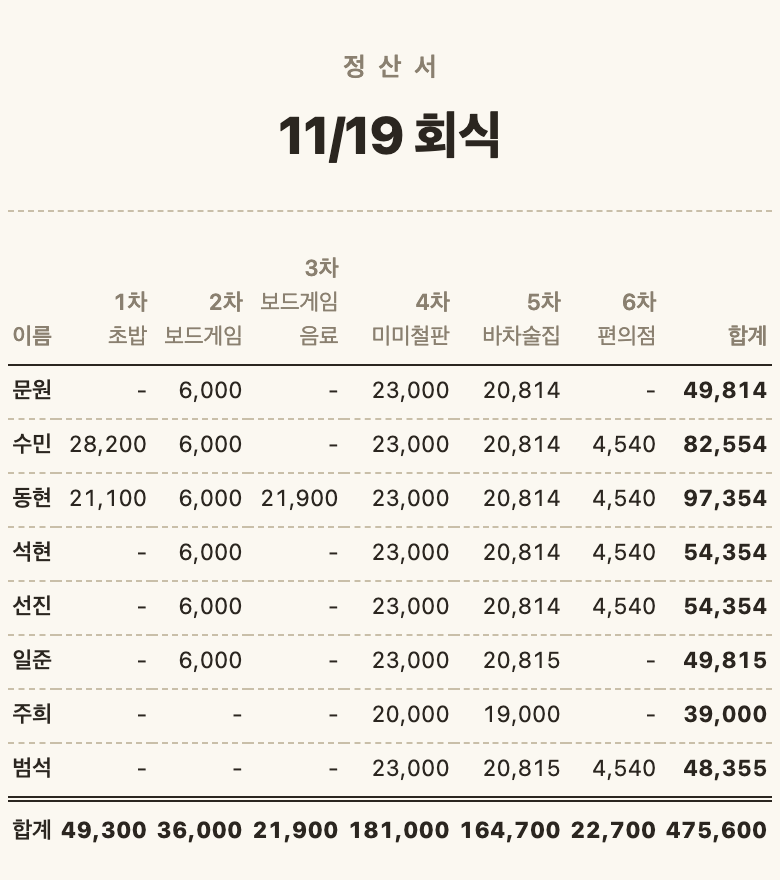

# meet-bill (모임 정산)

약속 뒤에 N차까지 간 회식비를 정산하는 웹 앱이에요. 인원과 차수별 금액을 입력하면 사람마다 낼 금액이 정산서 표로 나와요. 이 표를 캡처해서 메신저로 공유하면 돼요.



## 웹에서 바로 쓰기

<https://rosedskim.github.io/meet-bill/>

설치, 서버, 계정이 필요 없어요.

## 사용법

1. **모임명**을 입력해요. 정산서의 제목이 돼요. 비워 두면 `모임정산표`로 나와요.
2. **인원**을 등록해요. 이름을 입력하고 **등록**을 눌러요. 이미 있는 이름은 등록되지 않아요. 태그의 ×를 누르면 삭제해요. 그 사람이 어느 차수의 참석자로 선택돼 있으면 확인창이 뜨고, 삭제하면 그 차수들에서도 빠져요.
3. **차수 추가**를 눌러 차수를 만들어요. 차수 이름(선택)과 총금액을 입력하고, 참석한 사람의 태그를 눌러 선택해요. **전체선택**과 **전체해제**로 한꺼번에 고를 수 있어요. ▲▼로 차수 순서를 바꾸고, **삭제**로 차수를 지워요. 차수 번호는 순서대로 다시 매겨져요.
4. 참석자를 고르면 사람마다 낼 금액이 바로 보여요. 총금액을 참석자 수로 똑같이 나눈 값이에요.
5. 한 사람이 정해진 금액만 내면 그 사람의 **고정**을 체크하고 금액을 직접 입력해요. 나머지 참석자가 남은 금액을 나눠 내요.
6. 이미 돈을 보낸 사람은 그 차수에서 **보냄**을 체크해요. 정산서에서 그 칸의 금액 아래에 `보냄`이 작게 표시돼요. 열이 늘지 않고 합계도 그대로예요.
7. 차수를 모두 입력했으면 **결산**을 눌러요. 정산서가 나와요. 결산 뒤에 입력을 바꾸면 정산서도 바로 바뀌어요.
8. 정산서를 캡처해서 공유해요. 표를 파일로 받고 싶으면 **CSV로 저장**을 눌러요.

## 알아둘 점

- 입력은 이 브라우저(localStorage)에만 자동 저장돼요. 다른 기기에서는 보이지 않아요. 새로고침해도 입력은 남지만 정산서는 숨겨져요. **결산**을 다시 눌러요.
- **새로 시작**은 확인 뒤에 입력을 모두 지워요.
- 나누어 떨어지지 않는 1원 단위는 고정이 아닌 참석자 중 뒤에서부터 1원씩 더 내요. 순서는 인원 등록 순서예요. 더 내는 칸에는 `+1`이 표시돼요. 예를 들어 101원을 두 명이 나누면 앞 사람이 50원, 뒤 사람이 51원을 내요.
- 대납과 부담금 이전은 지원하지 않아요.
- 정산서 글자는 표 폭에 맞춰 작아져요. 폰 폭(390px)에서 차수가 많으면 더 작아지니, 캡처한 뒤 확대해서 봐요.
- 아래 경우에는 표 대신 고칠 곳을 알려 주는 안내가 나와요.
  - 총금액이 비었거나 0 이하예요.
  - 참석자가 0명이에요.
  - 고정 금액의 합이 총금액보다 커요.
  - 모두 고정인데 합이 총금액과 달라요.

## 내 PC에서 직접 실행하기

저장소를 받고 폴더 안에서 아래 명령을 실행해요.

```sh
python3 -m http.server 8000
```

브라우저에서 <http://localhost:8000>을 열어요. `index.html` 하나가 앱 전체라서 파일을 브라우저로 직접 열어도 돼요 (Chrome에서 확인했어요).
